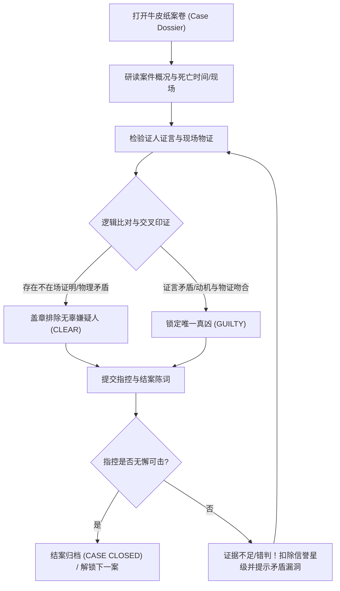

# 《侦探推演》（Detective）小游戏策划案

> 定位：本策划案由产品策划部门产出，旨在明确游戏的核心乐趣、对标参考、玩法规则与视觉风格。
> 供制作人（用户）拍板，随后即可直接交由开发部门（本地主代理端到端开发，或转外包发包）进行技术落地。
> 不包含具体代码、模块架构等技术实现细节（技术规范由开发契约保障）。

---

## 0 · 本地开发代理开工指令卡（可直接复制给 Codex / Antigravity / WorkBuddy / Grok Build）

> **【开工指令】请将以下提示词发给任何打开了 doin 项目目录的本地 AI 代理**：
>
> “你正在 `doin` 仓库工作区。请根据 `docs/plans/detective-prd.md` 策划案，在 `games/detective/` 开发并上线该游戏：
> 1. **阅读平台规范**：通读根目录 `AGENTS.md` 与 `docs/GAME-SPEC.md`，严格遵循纯静态模块分层、八大不可违背铁律、算法 100% 确定性可解保证；
> 2. **即开即玩与牛皮纸档案袋隐喻（严禁抄袭雷同）**：一打开游戏必须直接呈现就绪的 Case 01 案卷盘面开始玩（默认第 1 案或本地存档），**绝对严禁首屏弹出全屏选关或模式大遮罩阻塞玩家**；界面显眼处常驻醒目的「卷宗 / Cases」按钮供随时调用；依『侦探橡木桌台与牛皮纸档案袋』原生隐喻独立设计布局，**严禁连环照搬存量老游戏的左右双翼或木梁模版**；采用物理纸张摩擦噪声、重击印章敲击与打字机质感打造专属声效，严禁千篇一律单音蜂鸣器；
> 3. **立体质感与渲染路线**：采用纯语义 DOM + CSS 3D（折叠案卷、微浮雕便签、印章压痕与回形针金属光泽），零加载、零外部资源、秒开且不发烫；
> 4. **全量 i18n 与零副作用热更新**：所有案情、证词、线索与印章文案 100% 抽入 `js/i18n.mjs`，数据层（`cases.mjs`）严格使用语义键名（如 `case_01.clue_alibi_gardener`），严禁在逻辑或关卡数据中裸写中文；英文模式零汉字；**语言切换必须原地热更新文本与属性，绝对严禁 `location.reload()` 刷新页面，绝对不可重置正在进行的排查推演状态**！
> 5. **独立代码与四类测试**：在 `games/detective/` 产出完整语义标记、样式、纯逻辑模块与四类原生测试（`tests/*.test.mjs`），内置 Constraint Satisfaction 逻辑约束验证器，确保 12 案全部唯一有解；
> 6. **机器质检门禁**：运行 `node scripts/check-game.mjs detective` 确保 T1 零 fail，T2 零 warn；
> 7. **门户组装上架**：按 `docs/COVER-STYLE.md` 制作 640×640 软胶 WebP 封面放至 `assets/covers/detective.webp`，在 `games.json` 登记条目，在 `package.json` 注册 `test:detective`；
> 8. **构建与本地预览**：运行 `npm run test:detective` 与 `npm run build`，启动本地服务给出预览。”

---

## 1 · 创意概念与核心乐趣

- **游戏名称**：侦探推演 / Detective / `detective`
- **一句话玩法**：翻阅牛皮纸档案，研读证词与物证，盖上印章逐一排除嫌疑，锁定唯一真凶！
- **核心乐趣与卖点**：
  - **纯粹的“阿加莎式”逻辑推演快感**：摒弃冗长空洞的文本废话，每一份案卷都是高度精炼的逻辑互斥网络。没有任何故弄玄虚的情感主观臆断，全凭严格的时间线重叠、钥匙所有权、足迹泥渍等客观线索进行闭环排查；
  - **仪式感十足的物理办案手感**：翻动发脆的牛皮纸档案袋、拿起黄铜回形针固定的证词便签、对准嫌疑人肖像猛烈盖下清白「CLEAR」或真凶「GUILTY」印章，伴随沉重木质撞击反馈；
  - **“真相只有一个”的顿悟顿开**：当三条看似无关的琐碎证言在逻辑排查板上产生致命矛盾，瞬间撕碎嫌疑人的伪造不在场证明，那一刻的智力多巴胺直接拉满。
- **核心循环**：
  - 研读案情概要与时间线 ➔ 提取证词与随身物证 ➔ 标记排除矛盾嫌疑人 ➔ 收集并匹配作案工具与动机 ➔ 盖下拘捕印章定罪 ➔ 获得神探勋章并解锁下一宗神秘悬案。



---

## 2 · 经典标杆与对标参考

### 2.1 成熟标杆原型
1. **经典逻辑网格谜题（Einstein's Logic Grid / Zebra Puzzle）**：
   - 最纯粹的演绎推理范式，通过有限维度的互斥条件（人名、职业、地点、时间）逐格推演排除，具备绝对严谨的数学唯一解。
2. **《奥伯拉丁的归来》（Return of the Obra Dinn）与《金色偶像案》（The Case of the Golden Idol）**：
   - 现代独立游戏神作对“推理”的重构：不给玩家多余的文字干扰，只给最关键的身份、时间、凶器片段，让玩家体验自己作为侦探拼凑出因果拼图的无上成就感。
3. **经典桌面探案《妙探寻宝》（Cluedo / Clue）**：
   - 经典三要素“谁、在哪、用什么武器”（Suspect, Room, Weapon）的排查精髓与标记纸（Deduction Sheet）交互。

### 2.2 本作的独特魅力与微创新（Twist）
- **告别枯燥的数学表格，全面物化为沉浸式“档案袋实物桌面”**：
  - 传统的逻辑谜题往往只是一个干瘪的白底黑字勾叉表格，极易让人疲劳弃坑；
  - 《侦探推演》将逻辑网格完全包装为一张 **19 世纪末维多利亚/冷战时期的私家侦探工作台**：牛皮纸档案袋夹着泛黄打字机纸、黑白微雕肖像卡、随身物证袋、红蓝双色印章与红色推导虚线；
- **微小说与微证据架构（严格控量，彻底化解双语工作量）**：
  - 针对长篇推理文本难维护、双语工作量暴涨的痛点，本作采用**极简证据诗学**：每案仅包含 1 句案发导语 + 3~5 名嫌疑人各 1 句关键证词 + 2 件关键物证；
  - 全案文本量控制在极度精悍的 120~180 词以内，中英双语表达极度凝练，逻辑清晰刺骨，毫无阅读负担。

---

## 3 · 玩法规则与交互说明

### 3.1 盘面与案件构成
每个案件由四个核心视觉区域组成，布局在同一张沉浸桌面案卷上：
1. **卷宗抬头便签（Case Briefing Header）**：
   - 案件编号（如 `CASE #07`）、案发地点、受害者姓名、法医鉴定的精确死亡时间窗口（如 `21:15 - 21:45`）；
2. **嫌疑人档案卡廊（Suspect Lineup）**：
   - 3~5 名嫌疑人微雕立绘卡，注明身份（管家、遗孀、医生、园丁、画家）；
   - 每张卡片附带其关键口供（如“我整晚都在温室修剪玫瑰”）与随身检查发现（如“袖口有新鲜红墨水痕迹”）；
   - 卡片正下方配备三大状态戳记切换：**【存疑 ?】➔【排除 ⭕ 清白】➔【指认 ❌ 凶手】**；
3. **物证与现场线索展台（Evidence & Clues）**：
   - 案发现场搜出的关键物件（如破损怀表、带泥雨靴、带有苦杏仁味的茶杯、半张燃烧的信件）；
   - 点击可放大检验证物细节（文字描述简短有力）；
4. **结案判词栏（Final Indictment & Seal）**：
   - 包含【指认凶手】、【作案凶器】、【关键证据】三项下压式指认孔位，全部确认后，悬垂的重型黄铜印章变为高亮可点击，一键盖下结案！

### 3.2 玩家合法操作与交互流
- **单选/切换印章标记**：点击嫌疑人卡片右下角的印章轮盘，可在 `? (存疑)`、`CLEAR (排除)`、`GUILTY (凶手)` 之间快速切换；被标记为 `CLEAR` 的卡片轻度半透明下沉，帮助玩家在视觉上做排除法；
- **线索互斥高亮（Inspector's Insight）**：当玩家点击一条证言时，与该证言发生物理或时间冲突的物证/其他证言会产生极其克制的金黄柔光微闪，帮助理清因果链；
- **拖拽连线推演（可选辅助）**：桌面支持拖动红色毛线在嫌疑人与物证之间拉出假设关系线，视觉化推理过程；
- **指控定罪（Accusation）**：当且仅当玩家排除了其他所有无辜者，并锁定 1 名凶手及匹配的凶器与动机后，点击巨型结案印章。

### 3.3 数学严密性与 100% 唯一可解性（严禁死局与莫须有）
- 每一个案件均经过 **严格的形式化一阶命题逻辑（First-Order Propositional Logic）验证**：
  $$\text{Knowledge Base} \models (\text{Suspect}_i = \text{Killer}) \land \bigwedge_{j \neq i} (\text{Suspect}_j = \text{Innocent})$$
- 绝无任何歧义点与主观猜测。每案均满足三大硬性定理：
  1. **证据自洽性**：真实物证与客观事实（如现场脚印、死亡时间、门禁记录）绝对真确，不可被造假推翻；
  2. **谎言唯一定理**：凶手必然在关键时间或地点上撒谎，而清白者的证词除因视线盲区产生的客观局限外，绝不含作案伪证；
  3. **充分必要性**：利用案卷内给出的线索，有且仅有一组答案能同时满足所有约束条件，杜绝双解或无解。

### 3.4 即开即玩原则（Instant Play）
- 打开网页瞬间，直接呈现当前关卡（默认 `Case 01` 或本地进度）展开的桌面案卷，无任何全屏弹窗或选案菜单阻挡；
- 顶栏右侧常驻黄铜质感的 **【卷宗目录 / Cases】** 抽屉按钮，点击即可呼出优雅非阻塞的 12 宗案件档案盒，支持随时自由复盘重玩。

### 3.5 随时可暂停与失焦保护机制
- 本作为纯静态逻辑推演，天然无暴毙倒计时压力；
- 但为了满足侦探推演排位（神探三秒、敏锐直觉、审慎裁决评级），顶栏配备精致怀表计时器与实体 **【暂停 / 思考】（Pause/Resume）** 按钮（支持快捷键 `P`、`Space`、`Esc`）；
- 监听 `visibilitychange` 与 `window.blur`：当玩家切标签页查资料或接电话时，怀表秒针自动静止，防止推演耗时无故暴涨。

### 3.6 关卡编排与 12 案精密内容矩阵

针对用户关切的“12 案文本量与双语工作量”，全案文本严格控制在微小说精悍体量，分为三大循序渐进篇章：

| 案件编号 | 案件代号（中/英） | 嫌疑人数 | 核心逻辑维度 | 案发焦点与推理趣味 |
|:---:|:---|:---:|:---:|:---|
| **#01** | 雨夜书房案 / Midnight Study | 3 | 时间与钥匙排他 | 房门反锁，唯一钥匙在谁口袋里？ |
| **#02** | 晚宴毒酒案 / The Poisoned Chalice | 3 | 席位与传递顺序 | 毒药仅在第二道甜点，谁经手了银汤匙？ |
| **#03** | 画廊怪盗 / The Gallery Heist | 3 | 展厅出入通行证 | 三道感应门的刷卡日志交叉印证 |
| **#04** | 钟楼坠落 / Bell Tower Plunge | 3 | 泥渍与雨伞干湿 | 案发时暴雨倾盆，谁的斗篷竟然全干？ |
| **#05** | 列车包厢 / Compartment 4 | 4 | 铺位与列车时刻表 | 穿堂风吹熄了灯，谁在黑暗中跨过了车厢？ |
| **#06** | 炼金工坊 / Alchemist's Furnace | 4 | 试剂互斥与残渣 | 现场留下的酸性灼烧斑痕与手套反应 |
| **#07** | 暴风雪山庄 / Blizzard Lodge | 4 | 壁炉余温与滑雪板痕迹 | 雪地仅有三组单向脚印，谁从未离开？ |
| **#08** | 戏院后台 / Backstage Shadow | 4 | 幕布升降与道具枪真假 | 换装时间仅有 90 秒，唯一能完成装弹的人 |
| **#09** | 雾都码头 / Foggy Docks | 5 | 潮汐高度与缆绳系法 | 罕见的水手死结暴露了真凶的隐秘服役经历 |
| **#10** | 领事馆密室 / The Consulate Safe | 5 | 保险箱四位密码片断 | 每个人各持一位密码，指纹留在哪两个按键上？ |
| **#11** | 假面舞会 / Masquerade Deceit | 5 | 面具交换与香水残留 | 致命拥抱后留在领口的鸢尾花香气来自何人？ |
| **#12** | 终局博弈 / Checkmate Manor | 5 | 棋局走法与怀表停摆 | 未下完的残局第 24 步证明了死者的真正死亡时间！ |

### 3.7 双语核心词汇与数据键名规划

所有案件数据与线索在底层数据中全部采用标准语义键名，严格杜绝源码裸写中文：

```javascript
// cases.mjs 范例数据键名规范
export const CASES = [
  {
    id: "case_01",
    time_window: "21:00 - 21:30",
    suspect_ids: ["butler", "gardener", "doctor"],
    evidence_ids: ["study_key", "muddy_trowel", "torn_letter"],
    solution: {
      killer: "butler",
      weapon: "study_key",
      clue_link: "contradiction_timeline"
    }
  }
];
```

**i18n 字典映射规划（`js/i18n.mjs`）**：
- `roles`：管家 Butler / 园丁 Gardener / 医生 Doctor / 画家 Painter / 遗孀 Widow / 船长 Captain
- `stamps`：存疑 SUSPECT / 清白 CLEAR / 真凶 GUILTY / 结案 CASE CLOSED
- `actions`：指认凶手 Accuse / 检验证据 Inspect / 案件重置 Review / 卷宗目录 Case Archive
- `ranks`：传奇神探 Grand Sleuth / 敏锐督察 Senior Detective / 巡警助理 Police Constable

---

## 4 · 题材原生视窗隐喻与音色质感（拒绝抄袭雷同）

### 4.1 题材风格关键词
**维多利亚暗调工坊 / 做旧牛皮纸档案袋 / 褪色打字机墨迹 / 黄铜回形针 / 漆红火漆与橡胶印章**

### 4.2 专属视窗物理隐喻（绝对严禁左右双翼机台）
- **实体形态**：本作视窗彻底摒弃千篇一律的赛博仪表盘或左右双卡片，原生还原为 **摊开在深沉胡桃木桌面上的一整份案件卷宗（Dossier Desk）**：
  - **主体区（中央展开）**：大张做旧牛皮纸文件夹（Manila Folder），纸页边缘带有自然的磨损卷边与纸张纹理；
  - **纸面内容层**：
    - 左上角别着一枚黄铜回形针，别着一张带横线的黄色信笺，记录案件关键时间线；
    - 中间平铺 3~5 张拍立得黑白手绘嫌疑人肖像卡，底部留有手写签名与印章盖印槽；
    - 右下角散落着透明物证袋标签与打字机字条；
  - **底部实体托盘**：沉入桌面的一道木质凹槽，陈列着两枚金属手柄的实体印章（绿色 CLEAR 与红色 GUILTY）。玩家点击印章即可“执起印章”，随后在嫌疑人卡片上重重落下！
- **响应式排布**：
  - **桌面端（≥900px）**：宽幅横版案卷，线索便签与嫌疑人一览无余，案卷投射出柔和的深色纸张阴影；
  - **移动端（≤768px）**：自适应折叠为纵向侦探手账，嫌疑人卡片横滑阅览，底部留足广告安全避让间距（`max(68px, calc(16px + env(safe-area-inset-bottom)))`）。

### 4.3 立体质感与渲染路线判定
- **100% 纯语义 DOM + CSS 3D**：
  - 不需要加载任何外部 3D 引擎与模型，利用 CSS 强大的 `box-shadow`、`transform: rotate(-1.5deg)` 微倾斜、`border-image` 做旧纹理与压感位移，做出逼真的桌面纸质浮雕手感；
  - 秒开加载，零网络请求，在任何手机或弱网环境下均能满帧丝滑运行。

### 4.4 声效风格与材质音色规划（WebAudio 拟真程序化合成）
定制 6 种完全基于 WebAudio 物理与调频合成的真实材质音效，杜绝蜂鸣器：
1. **纸张翻阅声（Paper Rustle）**：白噪声缓冲通过带通滤波器（Bandpass Filter, 1200Hz - 3400Hz）进行轻微包络调制，模拟干燥纸页摩擦的沙沙声；
2. **印章重击盖印声（Stamp Thud）**：低通失谐双振荡器（65Hz 瞬态下滑）+ 快速噪声脉冲，模拟沉重实木橡胶印章撞击纸面与桌面的结实闷响；
3. **金属回形针/物证拾取（Metallic Clip）**：高频双正弦波（2400Hz + 2480Hz）极短衰减，发出清脆的黄铜金属触碰声；
4. **线索矛盾警示（Contradiction Jolt）**：低音突降锯齿波与轻度带阻滤波，提示推理逻辑发生断裂；
5. **逻辑贯通顿悟（Deduction Eureka）**：温润的 FM 马林巴和弦上升琶音（C-E-G-B 大七和弦），提供极度舒适的解密多巴胺；
6. **结案火漆封存（Case Closed Fanfare）**：沉闷庄严的法庭木槌三声微响 + 低沉的铜管余音。

---

## 5 · 战绩留存与后置流转规划

### 5.1 战绩档案卡（Platform-Agnostic Detective Dossier）
- 每破获一案，系统在本地生成一张极简典雅的 **【结案公告书（Case Closed Certificate）】**：
  - 居中盖有朱红色火漆印章；
  - 标明本案用时、推演排除准确率（是否一次锁定凶手，零误判）、解锁的侦探评级（如“伦敦苏格兰场特聘顾问”）；
  - 支持一键复制纯文本荣誉报告，中英双语自适应。

### 5.2 后置流转（Next Up Circulation）
- 当玩家通关某案或全通 12 案时，结算托盘以“桌面上放着的另外两份委托”优雅推荐站内高关联小游戏：
  - **《编程机器人》（Robot Lab / `robot`）**：“想要体验更严谨的纯逻辑执行？前往机器人实验室编写指令序列！”
  - **《终极井字棋》（Ultimate TTT / `ultimate`）**：“在九宫格中推演对手下一步战场，感受多层博弈的终极智斗！”
  - **《华容道》（Klotski / `klotski`）**：“在方寸棋盘间破解曹操突围之谜，体验纯粹的经典滑块推演！”

---

## 6 · 制作人拍板决策项（Producer Decisions）

请制作人对以下 3 项关键设计做出裁决（回复选项编号即可）：

1. **错判惩罚机制（Wrong Accusation Handling）**：
   - **选项 A（推荐：绅士扣星不重置）**：指认错误时，法官敲槌驳回指控（扣除 1 颗案件信誉星），高亮指出当前推论中的某一处关键逻辑漏洞（如“管家在案发时刻有可靠的不在场人证”），玩家继续留在当前案卷深入修正，不强制完全重头推演。
   - **选项 B（硬核侦探：三次错判封卷）**：每案拥有 3 次指控机会，3 次全部指控失误则“证据链断裂，真凶潜逃”，该案必须重置所有已打印章重新开始。

2. **逻辑助手与线索高亮强度（Helper Intensity）**：
   - **选项 A（推荐：点击互斥柔光提示）**：当玩家点击某嫌疑人口供时，与其在时间/地点上存在绝对物理矛盾的物证会有微弱呼吸柔光，降低纯文本脑力负荷。
   - **选项 B（纯硬核冷酷模式）**：界面不提供任何自动矛盾提示，完全靠玩家自行阅读证言并在脑海或便签纸上推演，最大化硬核本格推理乐趣。

3. **附加每日同题悬案（Daily Mystery）**：
   - **选项 A（推荐：首发专注 12 宗精雕案件）**：首发版本全力打磨 12 宗由浅入深、叙事精湛的名案，确保中英双语与逻辑 100% 零瑕疵；后续稳定后再推每日随机案件。
   - **选项 B（直接带上每日悬案模式）**：除 12 关战役外，直接利用 PRNG 确定性种子随机组合嫌疑人与时间线，生成每日由全球玩家竞速的 Daily Case。

---

## 7 · 下一步流转建议

- **模式 A（本地端到端）**：若确认上述决策，可直接在 `games/detective/` 建立工程骨架、编写 `cases.mjs` 逻辑约束求解测试并完成全部 UI 与 WebAudio。
- **模式 C（任务书发包）**：若需委托外包智能体多端协同制作，可调用 `/doin-waibao` 基于此策划案产出 `docs/outsource/detective-spec.md`。
